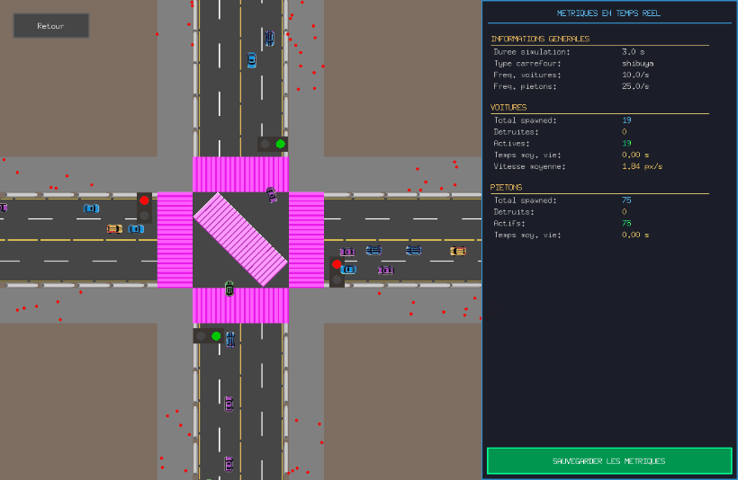
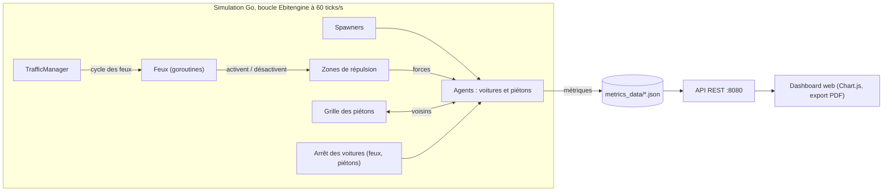
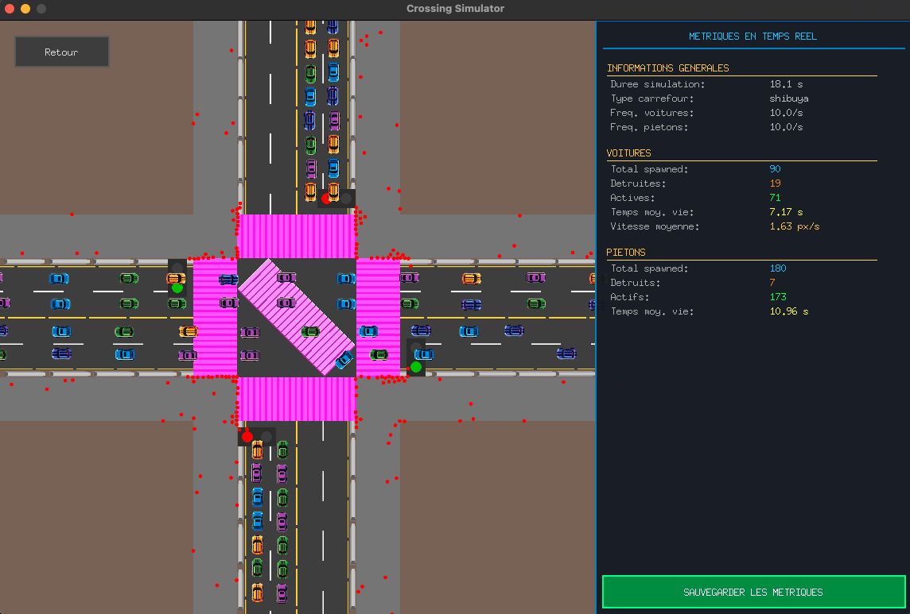
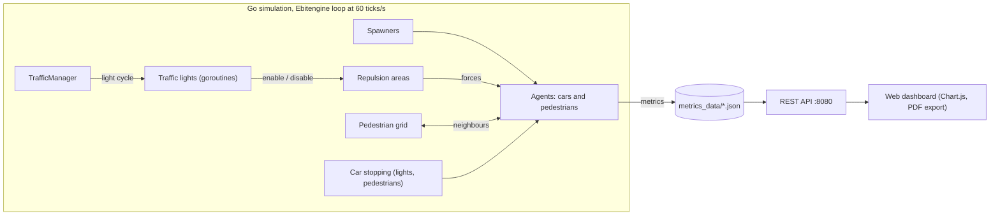

# 🚦 Shibuya Crossing Simulator

**🇫🇷 Français** · [🇬🇧 English version](#english-version)


Simulation multi-agents en Go du célèbre carrefour de Shibuya à Tokyo. Des centaines de voitures et de piétons autonomes se partagent l'intersection, les feux sont pilotés par des goroutines, et la simulation répond à une question : **le « scramble » japonais est-il plus efficace qu'un carrefour français classique ?**

<div align="center">
    
    <br/>
    <sub>Un cycle complet en mode Shibuya (accéléré ×3) : voitures Nord-Sud, puis Est-Ouest, puis tous les piétons en même temps, diagonales comprises.</sub>
</div>

## La question

Le carrefour de Shibuya fonctionne en trois phases séquentielles :
- circulation des voitures sur l'axe vertical (piétons à l'arrêt) ;
- circulation des voitures sur l'axe horizontal (piétons à l'arrêt) ;
- phase piétonne omnidirectionnelle : tous les passages passent au vert, y compris la **traversée en diagonale**.

Dans un carrefour français, au contraire, les piétons traversent en même temps que les voitures de l'axe parallèle, et les voitures leur cèdent le passage. Le projet simule les deux modèles avec les mêmes flux pour les comparer.

## Résultats

Une simulation de 60 s par scénario et par modèle, résultats présentés à la soutenance :

| Scénario | Voitures entrées<br/>Shibuya / France | Traversée voiture<br/>Shibuya / France | Traversée piéton<br/>Shibuya / France |
|---|:---:|:---:|:---:|
| Beaucoup de piétons (4 voitures/s, 50 piétons/s) | 119 / **164** | 21,8 s / **16,7 s** | 25,3 s / 25,7 s |
| Beaucoup de voitures (50 voitures/s, 10 piétons/s) | 185 / **252** | 19,5 s / **17,0 s** | 21,5 s / 21,7 s |
| Saturation (50 voitures/s, 50 piétons/s) | 182 / **233** | 20,1 s / **18,9 s** | 24,8 s / 25,8 s |

- **Efficacité :** le carrefour français fait entrer 28 à 38 % de voitures en plus et réduit leur temps de traversée de 6 à 23 %. Pour les piétons, les deux modèles se valent (moins d'1 s d'écart).
- **Sécurité :** Shibuya élimine tout conflit voiture-piéton en séparant complètement les flux dans le temps.

👉 **Le modèle français privilégie l'efficacité, Shibuya la sécurité.**

## Architecture



Chaque service (attribution des IDs, liste des agents, feux, spawns, grille des piétons, arrêt des voitures) tourne dans sa propre goroutine et communique par canaux. Les feux sont des acteurs : leurs objets visuels s'y abonnent, et ce sont eux qui activent ou désactivent les zones de répulsion des passages piétons.

| Technologie | Rôle |
|---|---|
| **Forces piétons/voitures** | Répartition spatiale des agents, qui gardent une distance minimale entre eux |
| **Grille des piétons** | Accélère la recherche des piétons voisins (requêtes envoyées par canal) |
| **A\* pathfinding** | Calcul du trajet des piétons |
| **Goroutines et channels** | Feux, spawns, grille et arrêts des voitures en microservices concurrents |
| **Serveur web** | API REST et dashboard comparatif (HTML, CSS, JavaScript, Chart.js, html2canvas, jsPDF) |
| **Ebitengine** | Moteur 2D et boucle de jeu |

## Équipe

Projet réalisé à 4 dans le cadre de l'UV AI30 (systèmes multi-agents) à l'UTC (Université de Technologie de Compiègne).

| Membre | Contribution |
|---|---|
| **Meïssa H'mida** ([@meissah](https://github.com/meissah)) | Voitures : virages en courbes de Bézier, spawn, force de répulsion · interface graphique et statistiques temps réel · API REST et dashboard |
| Ahmad Misselmani | Interface visuelle du carrefour, gestion des agents et des IDs, microservices de spawn et d'arrêt des voitures, boucle de jeu |
| Enzo Maros | Piétons : interactions entre piétons, zones de répulsion, grille de recherche |
| Pierrick Clause | Feux de circulation, passages piétons, pathfinding |

📑 [Diapositives de la soutenance (PDF)](docs/presentation_AI30.pdf)

## Lancer la simulation

**Prérequis :** [Go](https://go.dev/dl/) 1.25 ou plus et un navigateur web. Sous Linux, Ebitengine a besoin de quelques bibliothèques système ([voir leur guide d'installation](https://ebitengine.org/en/documents/install.html)).

```bash
git clone https://github.com/meissah/Multi-Agent_ShibuyaCrossing.git
cd Multi-Agent_ShibuyaCrossing
go run ./cmd/simulation
```

La commande se lance depuis la racine du dépôt, car les images sont chargées depuis `internal/assets/`. Les dépendances se téléchargent au premier lancement.

1. Dans le menu, réglez le nombre de voitures et de piétons par seconde, choisissez **Shibuya Crossing** ou **French Crossing**, puis cliquez sur **Valider**.
2. Pendant la simulation, le panneau de droite affiche les métriques en temps réel. **Sauvegarder les métriques** les enregistre dans `metrics_data/`. Une simulation dure au maximum 3 minutes.
3. Une fois les métriques des deux modèles sauvegardées, le bouton **Dashboard** du menu ouvre la comparaison dans le navigateur. Les données sont servies par l'API REST sur `http://localhost:8080/api/comparison`.

<div align="center">
    
    
</div>

## Limites et pistes d'amélioration

- Le carrefour est simplifié : il est carré et ne reproduit pas la géométrie réelle de Shibuya.
- Les voitures ne tournent pas à droite : il faudrait gérer les conflits de trajectoires.
- Au feu rouge, les piétons cherchent encore à traverser ; ce comportement est compensé par les zones de répulsion.
- La durée des feux n'est pas encore réglable depuis l'interface.

## Structure du projet

```
Multi-Agent_ShibuyaCrossing/
├── cmd/simulation/        # Point d'entrée
├── internal/
│   ├── agents/            # Agents : piétons, voitures, feux
│   ├── api/               # Serveur API REST
│   ├── assets/            # Images de la simulation
│   ├── config/            # Configuration de la simulation
│   ├── environment/       # Zones de spawn et de répulsion
│   ├── game/              # Boucle de jeu, affichage, menu
│   ├── handlers/          # Microservices (IDs, agents, spawns, grille, feux, arrêts)
│   ├── messaging/         # Requêtes envoyées à la grille des piétons
│   ├── pathfinding/       # A* pour les piétons
│   ├── stats/             # Collecte et comparaison des métriques
│   ├── ui/                # Composants d'interface
│   └── utils/             # Géométrie et utilitaires
├── docs/                  # GIF, captures et diapositives
├── dashboard.html         # Dashboard comparatif
└── dashboard.css
```

<sub>Template des diapositives : Slidesgo, avec des icônes Flaticon et des images Freepik.</sub>

---

# English version

**🇬🇧 English** · [🇫🇷 Version française](#-shibuya-crossing-simulator)

A multi-agent simulation, written in Go, of Tokyo's famous Shibuya Crossing. Hundreds of autonomous cars and pedestrians share the intersection, traffic lights are driven by goroutines, and the simulation answers one question: **is the Japanese "scramble" more efficient than a traditional French intersection?**

<div align="center">
    
    <br/>
    <sub>A full cycle in Shibuya mode (3× speed): north-south cars, then east-west cars, then every pedestrian at once, diagonals included.</sub>
</div>

## The question

Shibuya Crossing runs in three sequential phases:
- vertical vehicle traffic (pedestrians wait);
- horizontal vehicle traffic (pedestrians wait);
- an all-way pedestrian phase: every crosswalk turns green, **diagonal crossing** included.

In a French intersection, pedestrians instead cross alongside the parallel vehicle flow, and cars yield to them. The project simulates both models with the same traffic so they can be compared.

## Results

One 60-second run per scenario and per model, as presented at the final review:

| Scenario | Cars that got in<br/>Shibuya / French | Car crossing time<br/>Shibuya / French | Pedestrian crossing time<br/>Shibuya / French |
|---|:---:|:---:|:---:|
| Pedestrian-heavy (4 cars/s, 50 pedestrians/s) | 119 / **164** | 21.8 s / **16.7 s** | 25.3 s / 25.7 s |
| Car-heavy (50 cars/s, 10 pedestrians/s) | 185 / **252** | 19.5 s / **17.0 s** | 21.5 s / 21.7 s |
| Saturated (50 cars/s, 50 pedestrians/s) | 182 / **233** | 20.1 s / **18.9 s** | 24.8 s / 25.8 s |

- **Efficiency:** the French intersection lets 28–38% more cars in and cuts their crossing time by 6–23%. For pedestrians, both models are on par (less than 1 s apart).
- **Safety:** Shibuya removes every car-pedestrian conflict by fully separating the flows in time.

👉 **The French model wins on efficiency, Shibuya on safety.**

## Architecture



Each service (ID allocation, agent list, traffic lights, spawning, pedestrian grid, car stopping) runs in its own goroutine and communicates over channels. Traffic lights are actors: their visual objects subscribe to them, and the lights themselves enable or disable the crosswalk repulsion areas.

| Technology | Role |
|---|---|
| **Pedestrian/car forces** | Spatial spreading of agents, which keep a minimum distance from each other |
| **Pedestrian grid** | Speeds up neighbour lookups (requests sent over a channel) |
| **A\* pathfinding** | Pedestrian route planning |
| **Goroutines and channels** | Lights, spawning, grid and car stopping as concurrent microservices |
| **Web server** | REST API and comparison dashboard (HTML, CSS, JavaScript, Chart.js, html2canvas, jsPDF) |
| **Ebitengine** | 2D engine and game loop |

## Team

Built by a team of four for the AI30 course (multi-agent systems) at UTC (Université de Technologie de Compiègne, France).

| Member | Contribution |
|---|---|
| **Meïssa H'mida** ([@meissah](https://github.com/meissah)) | Cars: Bézier-curve turns, spawning, repulsion force · GUI and real-time statistics · REST API and dashboard |
| Ahmad Misselmani | Intersection visuals, agent and ID management, spawning and car-stopping microservices, game loop |
| Enzo Maros | Pedestrians: pedestrian interactions, repulsion areas, search grid |
| Pierrick Clause | Traffic lights, crosswalks, pathfinding |

📑 [Final review slides (PDF, in French)](docs/presentation_AI30.pdf)

## Running the simulation

**Requirements:** [Go](https://go.dev/dl/) 1.25 or later and a web browser. On Linux, Ebitengine needs a few system libraries ([see their install guide](https://ebitengine.org/en/documents/install.html)).

```bash
git clone https://github.com/meissah/Multi-Agent_ShibuyaCrossing.git
cd Multi-Agent_ShibuyaCrossing
go run ./cmd/simulation
```

Run the command from the repository root, since images are loaded from `internal/assets/`. Dependencies are downloaded on the first run.

1. In the menu, set the number of cars and pedestrians per second, pick **Shibuya Crossing** or **French Crossing**, then click **Valider** (confirm).
2. During the simulation, the right-hand panel shows live metrics. **Sauvegarder les métriques** (save metrics) writes them to `metrics_data/`. A run lasts at most 3 minutes.
3. Once metrics for both models are saved, the menu's **Dashboard** button opens the comparison in your browser. The data is served by the REST API at `http://localhost:8080/api/comparison`.

<div align="center">
    
    
</div>

## Limitations and next steps

- The intersection is simplified: it is square and does not match Shibuya's real layout.
- Cars cannot turn right yet: trajectory conflicts would need to be handled.
- At a red light, pedestrians still try to cross; repulsion areas compensate for it.
- Light durations cannot be changed from the interface yet.

## Project structure

```
Multi-Agent_ShibuyaCrossing/
├── cmd/simulation/        # Entry point
├── internal/
│   ├── agents/            # Agents: pedestrians, cars, traffic lights
│   ├── api/               # REST API server
│   ├── assets/            # Simulation images
│   ├── config/            # Simulation settings
│   ├── environment/       # Spawn and repulsion areas
│   ├── game/              # Game loop, rendering, menu
│   ├── handlers/          # Microservices (IDs, agents, spawning, grid, lights, stopping)
│   ├── messaging/         # Requests sent to the pedestrian grid
│   ├── pathfinding/       # A* for pedestrians
│   ├── stats/             # Metrics collection and comparison
│   ├── ui/                # Interface components
│   └── utils/             # Geometry and helpers
├── docs/                  # GIF, screenshots and slides
├── dashboard.html         # Comparison dashboard
└── dashboard.css
```

<sub>Slide template: Slidesgo, with icons from Flaticon and images from Freepik.</sub>
