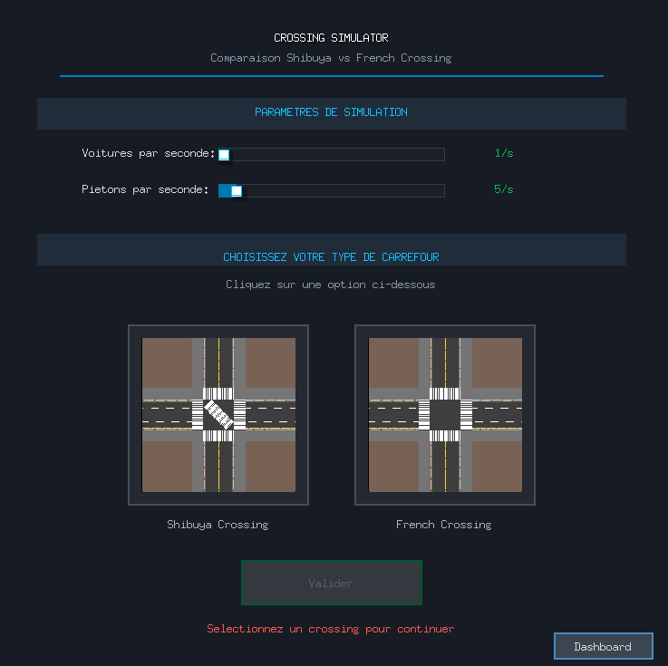

# 🚦 Shibuya Crossing Simulator

Shibuya Crossing Simulator est une simulation multi-agents d'un carrefour inspiré du célèbre passage piéton de Shibuya à Tokyo. Ce projet permet d'étudier et de comparer différents types de configurations de carrefours (Shibuya vs French Crossing) et d'analyser les flux de circulation de véhicules et de piétons. La simulation est écrite en Go et utilise le moteur de jeu [Ebiten](https://ebiten.org/).


<div align="center" style="margin-top: 20px">
    
</div>


<div align="center">
    
</div>


## Principales Technologies utilisées

- **Go** : Langage principal
- **Ebiten** : Moteur de jeu 2D
- **Serveur HTTP** : API REST pour la récupération des métriques en temps réel
- **HTML/CSS/JavaScript** : Dashboard web pour la visualisation et l'analyse des données

## Fonctionnalités

- **Simulation en temps réel** : Visualisation dynamique des mouvements de véhicules et de piétons
- **Deux types de carrefours** : Comparaison entre le système Shibuya (tous piétons simultanément) et le système French (passages piétons traditionnels)
- **Métriques détaillées** : 
  - Temps de traversée moyen
  - Vitesses moyennes
  - Nombre d'agents actifs et détruits
  - Durée de simulation
- **Dashboard web** : Interface de visualisation comparative avec graphiques et export PDF
- **API REST** : Récupération des métriques en temps réel
- **Configuration flexible** : Paramètres de simulation ajustables (taux de spawn, etc.)

## Prérequis

Avant de commencer, il faut s'assurer d'avoir installé :

- [Go](https://golang.org/dl/) version 1.25.0 ou supérieure
- Un navigateur web moderne (pour le dashboard)

## Installation

**Cloner le dépôt** :

```bash
git clone https://gitlab.utc.fr/amisselm/shibuyacrossing_ai30.git
cd shibuyacrossing_ai30
```

Les dépendances seront automatiquement téléchargées au premier lancement.

## Lancer la simulation

### Démarrage de la simulation

Pour lancer la simulation principale :

```bash
go run cmd/simulation/main.go
```

Ou depuis la racine du projet :

```bash
go run gitlab.utc.fr/amisselm/shibuyacrossing_ai30/cmd/simulation
```

### Accès aux interfaces

Une fois la simulation lancée, vous aurez accès à :

- **Fenêtre de simulation** : Interface graphique de la simulation (Ebiten)
- **API REST** : `http://localhost:8080`
- **Dashboard web** : Accessible via le bouton "Dashboard" dans l'interface de simulation


## Structure du projet

```
shibuyacrossing_ai30/
├── cmd/
│   └── simulation/
│       └── main.go              # Point d'entrée de la simulation
├── internal/
│   ├── agents/                  # Agents (piétons, véhicules, feux)
│   ├── api/                     # Serveur API REST
│   ├── config/                  # Configuration de simulation
│   ├── environment/             # Zones de spawn et de répulsion
│   ├── game/                    # Logique principale du jeu
│   ├── handlers/                # Gestionnaires d'agents
│   ├── pathfinding/             # Calcul des trajets optimaux pour les piétons
│   ├── stats/                   # Calcul et comparaison des métriques
│   └── ui/                      # Composants d'interface
├── metrics_data/                # Données de métriques sauvegardées
├── dashboard.html               # Dashboard de visualisation
├── dashboard.css                # Styles du dashboard
└── README.md                    # Ce fichier

```


## 👥 Auteurs

Projet réalisé dans le cadre du cours AI30 à l'UTC.
- Meïssa H'mida
- Ahmed Misselmani
- Enzo Maros
- Pierrick 

